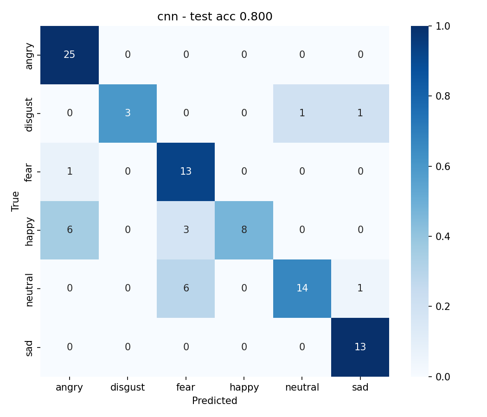

# Emotion Recognition from Speech (MFCC + CNN / LSTM / CNN-LSTM)

Recognises **angry, disgust, fear, happy, neutral, sad, surprise** from speech audio using
MFCC features and three deep-learning models, trained on RAVDESS, TESS and/or EMO-DB.

## 1. Pipeline

```
 .wav ──► trim silence ──► fix to 3 s ──► MFCC(40) + Δ + ΔΔ ──► normalise ──► model ──► emotion
                                    ▲
              (train only) noise / pitch-shift / time-stretch augmentation
```

| Stage | Details |
|---|---|
| Preprocessing | 22.05 kHz mono, silence trimmed (top_db=25), centre-crop / zero-pad to 3 s |
| Features | 40 MFCCs, window 1024, hop 512, plus delta and delta-delta → tensor `3 × 40 × 130` |
| Augmentation | Train set only: Gaussian noise (SNR 15–30 dB), pitch ±2 semitones, speed 0.9–1.1× |
| Normalisation | Per-channel mean/std from the **training set only** (saved in the checkpoint) |
| Models | **CNN** (4 conv blocks) · **BiLSTM** (2 layers, mean+max pooling) · **CNN-LSTM** (3 conv blocks → BiLSTM) |
| Training | AdamW, class-weighted cross-entropy + label smoothing 0.1, ReduceLROnPlateau, early stopping on val macro-F1 |
| Evaluation | Accuracy, macro-F1, per-class precision/recall, confusion matrix, training curves |

### Label harmonisation
| Shared label | RAVDESS | TESS | EMO-DB |
|---|---|---|---|
| angry | angry | angry | W (Wut) |
| disgust | disgust | disgust | E |
| fear | fearful | fear | A (Angst) |
| happy | happy | happy | F |
| neutral | neutral + calm | neutral | N |
| sad | sad | sad | T (Trauer) |
| surprise | surprised | ps (pleasant surprise) | – |

RAVDESS song files and EMO-DB "boredom" are dropped.

### Avoiding data leakage
If ≥ 8 speakers are present (RAVDESS has 24 actors, EMO-DB 10), the split is
**speaker-independent** (train/val/test contain different people). TESS alone has only
2 speakers, so it falls back to a stratified random split — expect inflated scores there
(TESS is typically >95%). Combining datasets gives a more honest benchmark.
Augmented copies are only generated *after* splitting, so they never leak into val/test.

## 2. Setup

```bash
pip install -r requirements.txt
```

Download datasets (Kaggle or original sources) and unzip:
- RAVDESS – "Ryerson Audio-Visual Database of Emotional Speech and Song" (speech part, `Actor_01…24`)
- TESS – "Toronto Emotional Speech Set"
- EMO-DB – "Berlin Database of Emotional Speech" (folder of `*.wav`)

```
data/
 ├─ RAVDESS/Actor_01/03-01-05-01-01-01-01.wav ...
 ├─ TESS/OAF_angry/OAF_back_angry.wav ...
 └─ EMODB/wav/03a01Fa.wav ...
```
Folder names don't matter – files are discovered recursively and labelled from file names.

## 3. Run

```bash
python tests/test_data.py                                   # sanity-check label parsing

# train one model
python -m ser.train --ravdess data/RAVDESS --tess data/TESS --emodb data/EMODB \
                    --model cnnlstm --epochs 60 --augment

# train + compare all three
bash run_all.sh data/RAVDESS data/TESS data/EMODB

# predict on a new recording
python -m ser.predict --ckpt outputs/cnnlstm/model.pt --audio my_voice.wav
```
Outputs per model in `outputs/<model>/`: `model.pt`, `metrics.json`, `confusion_matrix.png`, `training_curves.png`.
Features are cached in `cache/` so reruns are fast. A GPU (e.g. free Colab T4) makes training take minutes;
CPU works but is slower, especially with `--augment`.

## 4. Results (EMO-DB, 6 emotions, speaker-independent split)

| Model | Test accuracy | Macro-F1 |
|---|---|---|
| **CNN** | **80.0%** | **0.783** |
| BiLSTM | 70.5% | 0.679 |
| CNN-LSTM | 70.5% | 0.639 |

Additional experiments (CNN):

| Experiment | Accuracy | Macro-F1 |
|---|---|---|
| Seeds 42 / 1 / 2 | 80.0% / 58.3% / 75.8% | 0.783 / 0.532 / 0.671 |
| Mean over seeds | 71.4% ± 9.4% | 0.662 ± 0.103 |
| Without augmentation (seed 42) | 53.7% | 0.514 |

Confusion matrix of the CNN (seed 42):



Notes: the test set holds only one or two unseen speakers (~95 clips), so scores vary a lot between splits.
The CNN was selected using its seed-42 test score, so 80.0% is slightly optimistic; the seed mean (71.4%) is the safer figure.
Most common errors: happy confused with angry/fear, neutral confused with fear.

## 5. Report outline (for submission)

1. **Introduction** – speech emotion recognition, applications (call centres, mental-health monitoring, HCI).
2. **Datasets** – size, speakers, emotions, acted-speech limitation.
3. **Method** – the pipeline above; why MFCC (compact model of vocal-tract spectrum, perceptually motivated mel scale);
   why deltas (capture dynamics of prosody); why CNN (local spectro-temporal patterns), LSTM (temporal context), CNN-LSTM (both).
4. **Experiments** – splits, hyper-parameters, augmentation ablation (`--augment` on/off).
5. **Results** – table, confusion matrices, curves, error analysis.
6. **Limitations & future work** – acted vs. spontaneous speech, cross-corpus generalisation, add attention,
   wav2vec2/HuBERT embeddings, SpecAugment, real-time microphone demo.

## 6. Project layout
```
ser/data.py      dataset indexing + label mapping
ser/features.py  loading, augmentation, MFCC
ser/models.py    CNN, LSTM, CNN-LSTM
ser/train.py     training / evaluation / plots
ser/predict.py   single-file inference
tests/           label-parsing tests
```
